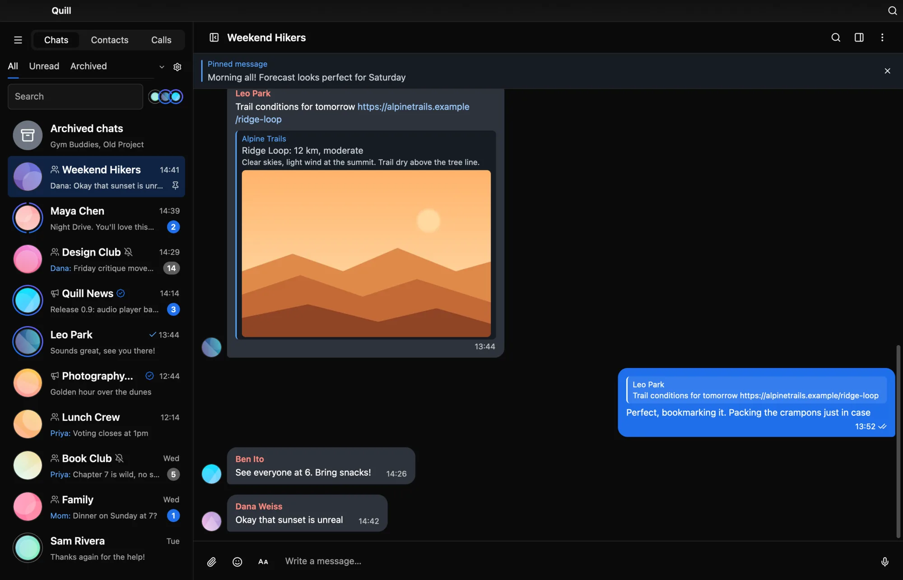
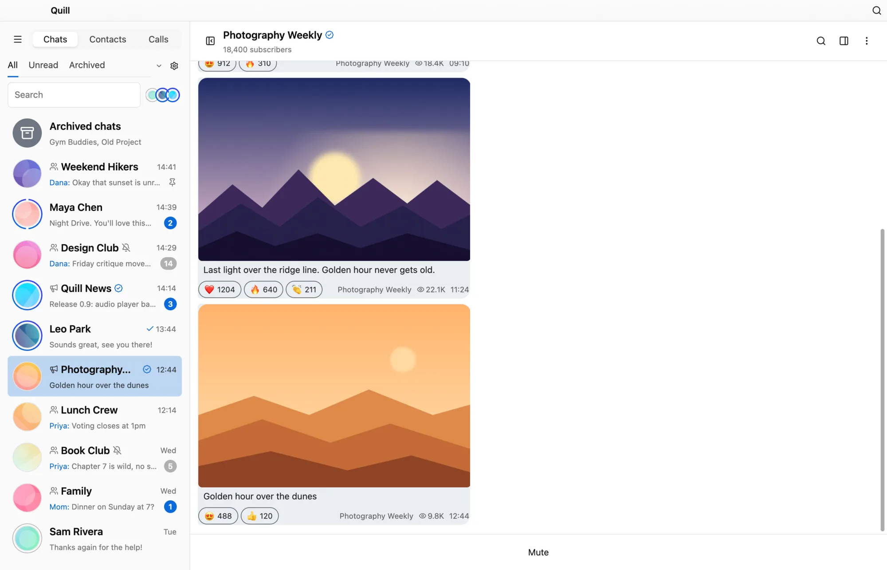
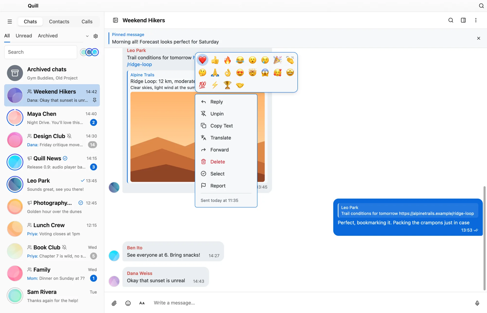
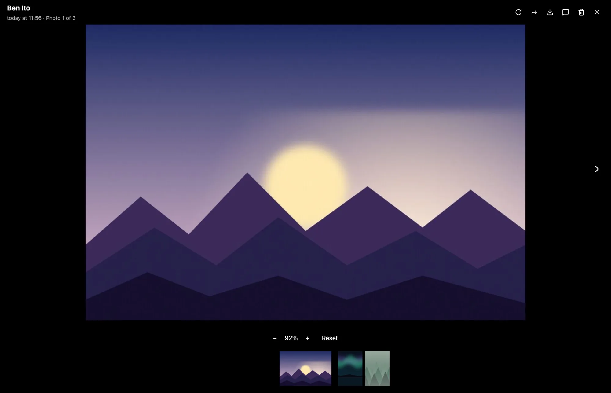

# Quill: a fast Telegram client for macOS, Windows and Linux

[](https://github.com/shinycake/quill/actions/workflows/ci.yml)


Quill is a free, open-source Telegram desktop client written from scratch in Rust. You sign in with your normal Telegram account and get your real chats, groups, channels and calls. It talks to Telegram through [TDLib](https://core.telegram.org/tdlib), Telegram's own client library, and draws its whole interface on the GPU with [GPUI](https://www.gpui.rs), the UI framework from the Zed editor. There's no browser engine or web view inside.

On the same Mac, Quill used about a third of Telegram Desktop's memory and put its window on screen about four times faster on a warm launch ([numbers below](#how-it-compares-with-telegram-desktop)).

**Website and install:** [shinycake.github.io/quill](https://shinycake.github.io/quill/)

> [!WARNING]
> Quill is an independent project. It isn't affiliated with, endorsed by, or sponsored by Telegram (Telegram FZ-LLC or Telegram Messenger Inc.). "Telegram" is a trademark of its owner, and Quill uses the name only to say which service it works with.
>
> Quill is early, experimental software. Use it at your own risk. It comes with no warranty, as the [MIT license](LICENSE) states, and the maintainers are not responsible for lost data, account restrictions or bans, missed messages, or any other damage. Keep an official Telegram app installed.

<table>
  <tr>
    <td></td>
    <td></td>
  </tr>
  <tr>
    <td></td>
    <td></td>
  </tr>
</table>

Captured from a real Quill window signed in to a demo account.

## Install

On a Mac (macOS 14 or later, Apple Silicon), paste this into Terminal:

```sh
curl -fsSL https://raw.githubusercontent.com/shinycake/quill/main/scripts/macos-install.sh | bash
```

On Windows (10 or later, x64), paste this into PowerShell:

```powershell
irm https://raw.githubusercontent.com/shinycake/quill/main/scripts/windows-install.ps1 | iex
```

On Linux (x86_64 or arm64, glibc), paste this into a terminal:

```sh
curl -fsSL https://raw.githubusercontent.com/shinycake/quill/main/scripts/linux-web-install.sh | bash
```

Each script downloads the latest release from [GitHub Releases](https://github.com/shinycake/quill/releases) and checks it against the release's SHA-256 checksums. If the file doesn't match, the script stops and installs nothing. None of them needs administrator rights. Run the same command again to update.

Quill isn't signed with a paid Apple or Microsoft certificate yet. A zip downloaded in a browser therefore needs a one-time confirmation on first launch: on a Mac, Open Anyway under System Settings > Privacy & Security; on Windows, More info > Run anyway. Files the scripts download aren't marked for that check, so they open without a warning. The [website](https://shinycake.github.io/quill/#install) walks through both routes step by step.

## Features

- **Messages:** bold, italic, code, spoilers, quotes and links. Replies and quote-replies, forwarding, scheduled and silent messages, cloud drafts, search inside a chat, reactions and polls.
- **Media:** photos, videos, albums, GIFs and stickers. Voice and video messages recorded in the app, with transcription. A fullscreen media viewer, an audio player bar, link previews and a downloads list.
- **HDR photos:** a photo sent as a file is shown in high dynamic range, with an HDR tag in the chat and the viewer. On a Mac with an XDR or HDR screen this covers iPhone HEIC with a gain map, and AVIF or HEIC in PQ or HLG. On Windows with HDR turned on, it covers Ultra HDR and gain-map JPEG from Android phones, and HDR JPEG XL.
- **Calls:** one-to-one audio and video calls with screen sharing, and group voice chats.
- **Groups and channels:** admin tools, invite links, join requests, forum topics, comments, and statistics with growth charts. Bots with keyboards, inline results and games.
- **Privacy and accounts:** secret chats, a local passcode lock, active-session management and two-step verification. Sign in with a phone code, a QR code or a password, and switch between several accounts.
- **Your setup:** light and dark themes with automatic night mode, accent colors, chat wallpapers, text size, and bubble or plain message layouts. `tg://` and `t.me` links, a tray menu and unread badges.

[STATUS.md](STATUS.md) lists every feature one by one, and the [progress dashboard](https://shinycake.github.io/quill-dashboard) charts it over time.

## How it compares with Telegram Desktop

Both apps ran on the same Mac, signed in to the same Telegram account, each with its own local cache.

| Measurement | Quill compared with Telegram Desktop |
| --- | --- |
| Memory a minute after launch | About a third as much |
| Memory after opening five chats | About 40% as much |
| Window on screen, warm launch | About 4× faster |
| Window on screen, cold launch | About 2× faster |

The machine was an Apple M1 Pro with 16 GB running macOS 27.0.1.

- **Memory:** physical footprint from macOS `footprint`, which includes GPU memory. Each comparison uses the median of three runs per app. Measured on 8 October 2026 against Telegram Desktop 7.2.9.
- **Launch:** the time until the window is on screen. A cold launch empties the file cache first. Measured on 18 October 2026 against Telegram Desktop 7.3.1.

Windows and Linux haven't been measured yet.

## Privacy

Quill runs on your computer and keeps its data there. The local database is encrypted with a key held in the macOS keychain, Windows DPAPI, or a private file on Linux. Quill has no server of its own and no analytics. Besides Telegram, it only contacts GitHub to check for updates, and you can turn that off in Settings.

## Use Quill with an AI agent

Agent access lets an AI agent on your computer, such as Claude Code, Claude Desktop or Cursor, use your Telegram account through the Quill that is already running. It's off by default, and while it's off the only trace is one switch in Settings > Advanced. Turn it on in Settings > Advanced > Agent access, then connect an agent:

```sh
claude mcp add quill -- /Applications/Quill.app/Contents/MacOS/quill mcp   # Claude Code
quill agent connect claude-desktop --yes   # or cursor: adds Quill to the app's config, after a backup
quill agent install-skill                  # the Quill skill for Claude Code
```

`quill` is Quill's own executable (on Windows `%LOCALAPPDATA%\Programs\Quill\quill.exe`, on Linux `~/.local/bin/quill`). Scripts and agents that don't speak MCP use the same tools from the command line: `quill agent status`, `quill agent read --chat saved`, `quill agent send --chat @some_bot --text /start`, or `quill agent call <tool> --json '{…}'` for any tool. `quill agent --help` lists every command and exit code. On Windows, run these commands with `quill-cli.exe` from the same folder (`quill-cli agent status`): `quill.exe` is a windowed program, so a terminal doesn't wait for it or get its exit code, and `quill-cli.exe` does both.

Agents can read the chats you grant (by default Saved Messages, bots and your own channels), search them, send and edit messages, react, and manage drafts and folders. They can also make raw TDLib calls under the same grants and, if you turn on a second switch, click and type in Quill's window. Quill asks you before an agent goes outside its grants. Every send shows in an activity log, can wait for your click, and is paced to stay inside Telegram's limits.

Some limits hold whatever the agent asks. Quill never sends your data to an AI service itself; the agent you run asks Quill for it. There's no network listener, only a local socket with a per-launch token. Read receipts, online status and typing are never hidden, there's no bulk export, and Telegram's terms don't allow training AI models on your chats. The [agent guide](src/agent/guide.md) has the tools, recipes and errors.

## Build from source

[docs/build.md](docs/build.md) covers each platform and the packaging scripts. The short version:

```bash
cargo test --no-default-features
cargo run --features ui          # live connect with your Telegram credentials + tdjson
cargo run --no-default-features -- --connect-smoke   # headless WaitPhoneNumber gate
```

Without credentials, `cargo run --features ui` opens a synthetic demo chat. To sign in to a real account from your own build, get an API ID and hash from [my.telegram.org](https://my.telegram.org) and build TDLib with `scripts/build-tdlib.sh`. Then set `TELEGRAM_API_ID` and `TELEGRAM_API_HASH` in the environment or in a gitignored `quill.local.env` file, and point `QUILL_TDJSON_PATH` at the library. [docs/credentials.md](docs/credentials.md) has the details. Don't reuse another app's API ID: Telegram's [API terms](https://core.telegram.org/api/terms) require every app to have its own. Release packages already include Quill's own.

On Linux, building the UI also needs the GTK 3 and ALSA development packages (`libgtk-3-dev` and `libasound2-dev` on Debian and Ubuntu).

Toolchain: Rust 1.99.1, pinned in `rust-toolchain.toml` (the minimum supported version is 1.92). UI: gpui-kit 0.8.0. TDLib: 1.8.69.

## Questions

**Is Quill an official Telegram app?** No. It's an independent open-source client that uses the public Telegram API under Telegram's [API Terms of Service](https://core.telegram.org/api/terms).

**Can my account get banned for using it?** Quill follows Telegram's rules for third-party apps as closely as it can, but Telegram decides what it allows and nobody can promise anything. Keep an official app installed.

**Is it free?** Yes. Quill is free software under the MIT license.

**Which systems does it run on?** macOS 14 or later on Apple Silicon, Windows 10 or later on x64, and Linux on x86_64 or arm64 with glibc, a Vulkan driver and GTK 3.

## License

Quill is released under the [MIT License](LICENSE). The packages also contain third-party components under their own licenses, among them TDLib (BSL-1.0), OpenSSL (Apache-2.0), FFmpeg (LGPL-2.1 or later, Linux and Windows only), the ntgcalls call engine (LGPL-3.0) and the ThorVG sticker renderer (MIT). [THIRD_PARTY.md](THIRD_PARTY.md) lists every component. The license texts are in [licenses/](licenses), and the licenses of the Rust crates are in [THIRD_PARTY_LICENSES.md](THIRD_PARTY_LICENSES.md). In the app, Settings → Appearance → About Quill → Open-source licenses opens the same list.

## Contributing

Pull requests are welcome. Before you open one, run the checks from the Linux CI job:

```bash
cargo fmt --all -- --check
cargo clippy --no-default-features --all-targets -- -D warnings
cargo test --no-default-features
```

Feature PRs don't edit `STATUS.md` or `DECISIONS.md`. List the checklist items you finished in `parity-fragments/<slice-id>.txt` and write your notes in `docs/decisions/<slice-id>.md`; the merge pipeline updates [STATUS.md](STATUS.md) after the merge. Older decisions, pins and blockers are archived in [DECISIONS.md](DECISIONS.md). Never commit API credentials.
