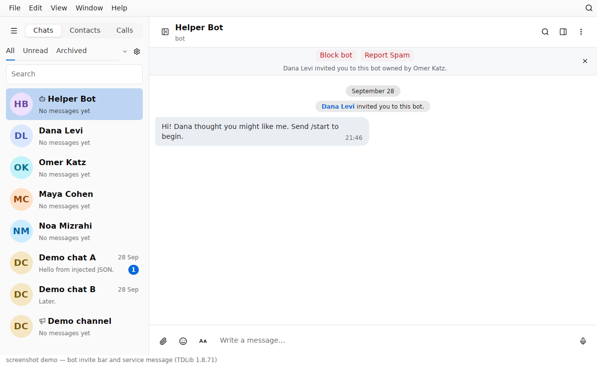
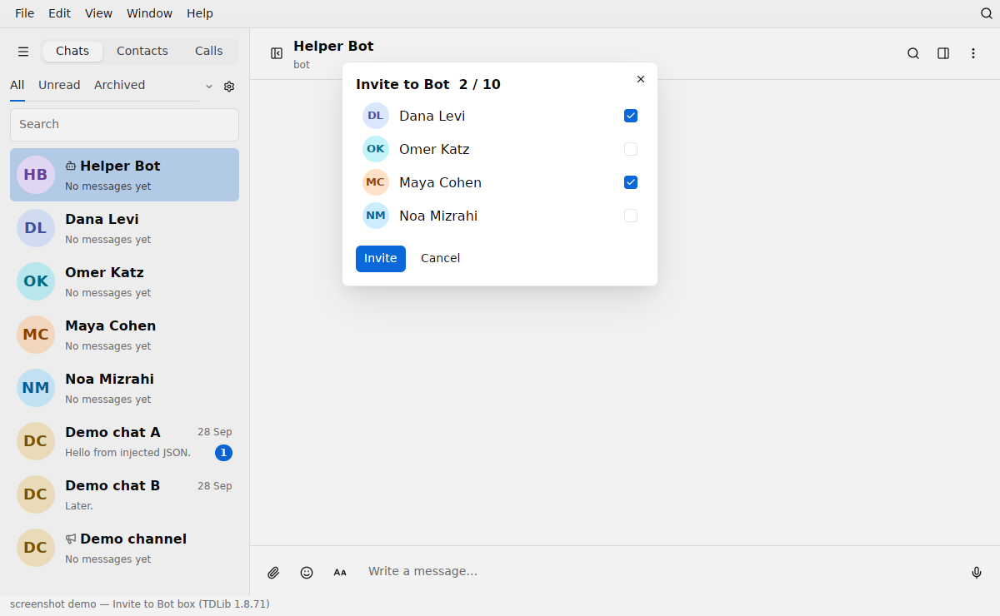
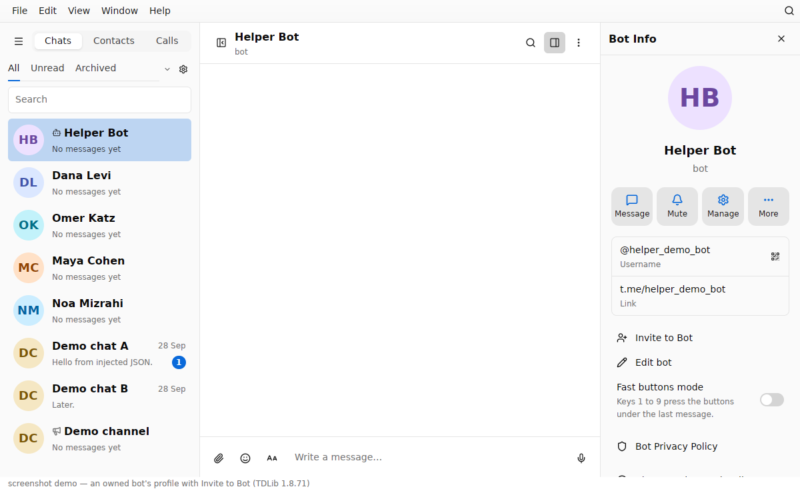
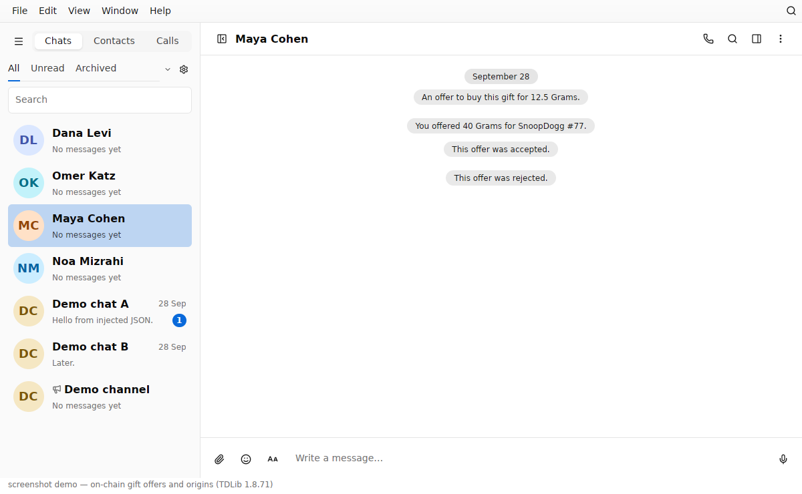

# TDLib 1.8.71

Pin moved from `23383aef218a3123f02b744bfa91bde21056a814` (1.8.70) to
`1b9efe84d6e9a2e2f6eadeeea32b0726d2b8c25d` (tdlib/td master, 150 upstream
commits). tdlib/td and telegramdesktop/tdesktop stayed read-only; tdesktop
(`dev`, `070dbc6`, 2026-11-23) was read for behavior only, no code copied.
Procedure: the "TDLib" section of `docs/dependency-updates.md`.

## What changed in the pin

- `src/pins.rs`: `TDLIB_GIT_COMMIT`, `TDLIB_CMAKE_VERSION` 1.8.71,
  `TD_API_TL_SHA256` `bf68db11…912384c1b1`, `TD_API_TL_BYTES` 1,236,740 to
  1,277,521, `TD_API_TL_UPSTREAM_URL`.
- `schema/td_api.tl` re-vendored with `scripts/vendor-td-schema.sh`;
  `schema/README.md`, `docs/build.md`, `THIRD_PARTY.md`, `ROADMAP.md`, the
  README toolchain line. The agent's "unknown method" error now reads the
  version from `pins.rs` instead of a hard-coded "1.8.70".
- `native/patches/tdlib-quill-takeout-contacts.patch`: the `td_api.tl` hunk
  moved by ~390 lines; applied with `git apply --3way`, regenerated from
  `git -C native/td diff` (same hunks, new offsets and index lines).

Schema diff (constructors, by name): **68 added, 2 removed, 14 changed**.

## Removed

| Constructor | Quill | Now |
|---|---|---|
| `getUpgradedGiftWithdrawalUrl` | The gift export chain ("Send via Blockchain" → Fragment page) and its password-less probe | Renamed upstream to **`getGiftMintingUrl`** (same parameter, same `httpUrl`; commit 86132df "Improve names of getGiftMintingUrl and mintGift"). Request builder, purposes' docs, driver, tests and the agent's money list switched to the new name. tdesktop still calls the same MTProto method (`payments.getStarGiftWithdrawalUrl`). |
| `withdrawUpgradedGift` | Never sent (the "Move to My Wallet" row already opens the wallet notice, `WalletSurface::GiftToWallet`) | Renamed to `mintGift`. Not adopted: it mints into the TON wallet (TON rule). The agent policy blocks `mintGift`. |

## Changed

| Constructor | Change | Quill |
|---|---|---|
| `chat` | `+text_composition_parameters` | Ignored field; see `textCompositionParameters` below. |
| `getForumTopics` | `+icon_custom_emoji_id`, `+exclude_open`, `+exclude_closed` | Sent explicitly as 0/false: tdesktop never filters topics by icon or open state (`data_forum.cpp`, `dialogs_widget.cpp`, `peer_list_controllers.cpp`). |
| `searchGiftsForResale` | `+for_grams`, `+for_fragment` | Sent false. Both list gifts bought with TON (on-chain fixed-price sales, Fragment); with neither set TDLib leaves on-chain sales out, so Quill never offers a gift it could only buy with a TON wallet. tdesktop's "TON only" / Fragment filters are not mirrored (TON rule). |
| `giftResaleParameters` | `+gram_amount`, `+is_fixed_on_chain`, `+can_be_managed` | An own gift on on-chain resale (see `upgradedGift.uses_on_chain_resale`) reads as TON-only: the resale gate is `TonOnly` ("change the listing in an official app"). Test: `resale_gate_needs_a_resale_date_or_a_listing`. |
| `upgradedGift` | `+uses_on_chain_resale`, `+fee_basis_points`, `+min_on_chain_purchase_offer_gram_amount` | `uses_on_chain_resale` drives the TonOnly gate above; the other two only matter for on-chain offers Quill never sends. |
| `upgradedGiftValueInfo` | `minimum_price` → `min_price` | Parser and both recorded fixtures (`tests/fixtures/gift_value/*.json`) renamed. Without this the "Minimum price" row silently vanished (caught by `the_table_has_every_known_row`). |
| `upgradeGiftResult`, `receivedGift`, `messageUpgradedGift` | `export_date` → `mint_date` | Renamed through `GiftManageInfo::mint_date`, the transfer picker's export row and the demos. |
| `pageBlockExpandableBlockQuote` / `inputPageBlockExpandableBlockQuote` | `text:RichText` → `blocks:vector<PageBlock>` | Rich messages: the collapsible quote is built from the joined blocks (first line header, rest body) in `rich/parse.rs`; quote extraction (`rich/quote.rs`) and the HTML export (`rich_html/blocks.rs`) walk the blocks like `pageBlockBlockQuote`. Quill never sends the input variant. Test: `an_expandable_quote_keeps_header_and_body_formatting`. |
| `messageTonWalletTransfer` | `+on_ramp_provider_name` | Not read (TON rule; the transfer card is unchanged). |
| `tonWalletTransaction` | `+is_suspected_spam` | Not read (TON wallet). |
| `replyToCallbackQueryWithEphemeralMessage` | returns `Message` instead of `Ok` | Bot-only; Quill never calls it. |

## Added

### Bot invites (adopted, as tdesktop)

tdesktop: `history_item_bot_invite.cpp`, `boxes/peers/invite_to_bot_box.cpp`,
`ContactStatus` `Type::BotInvite`, `deep_links_new.cpp` `ShowBotInvite`,
`info_profile_actions.cpp` `makeInviteToBot`, `data_web_page.cpp`.

| Constructor | Where in Quill |
|---|---|
| `messageBotInvite` | `ServiceAction::BotInvite`; "{user} invited you to this bot." when the bot posts it, "{from} was invited by {user}." otherwise (`lng_action_bot_invited_you/_user`). |
| `chatActionBarBotInvite` | `ChatActionBar::BotInvite`; bar `ui/chat_bars/bot_invite.rs`: Block bot (the block box without the report tick, tdesktop's `suggestReport = false`), Report Spam (confirm "report {user}, who invited you…", then `reportChat` with no option and no messages, which reports the inviter), close, and the "{user} invited you to this bot (owned by {owner})" line. No Unarchive, as tdesktop. Stored by the existing `updateChatActionBar` path. |
| `inviteUsersToBot` | "Invite to Bot" box (`ui/invite_to_bot_box.rs`, model `invite_to_bot.rs`, driver `connect/invite_to_bot.rs`): people from the chat list (no self, bots or deleted accounts), up to 10 (toast `lng_bot_invite_limit`), Invite / Cancel, title with "n / 10". Stage `Sending { request }`; the answer is matched by its `RequestId` through `session.acks`, refusals by the same id in `bots.invite_refusals` (`BOT_INVITE_ALREADY_STARTED`, `BOT_INVITE_FAILED`, else the error line). Reached from the bot profile ("Invite to Bot", only when `can_be_edited`) and from links. |
| `internalLinkTypeBotInvite` | `InternalLink::BotInvite` → `DeepLinkAction::InviteToBot`: `searchPublicChat`, then the box for an owned bot, else the bot's chat (tdesktop `ShowResolvedBotInvite`). |
| `linkPreviewTypeBotInvite` | Link preview button "Invite to Bot" (`lng_view_button_botinvite`); the button opens the link, which takes the path above. |

### On-chain gifts (TON rule: readable text, no action)

| Constructor | Quill |
|---|---|
| `messageUpgradedGiftOnChainPurchaseOffer` + `giftOnChainPurchaseOfferState*` (7) | `ServiceAction::GiftOnChainOffer`: "You offered {cost} for {name}." / "An offer to buy this gift for {amount}." while pending, settled or canceling; "This offer was accepted." / "…rejected." once accepted, or declined, canceled or expired. Amounts are Grams. No Accept/Decline: answering moves TON. tdesktop has no on-chain message action in its scheme yet, so the wording reuses the existing offer strings. |
| `upgradedGiftOriginOnChainResale`, `upgradedGiftOriginOnChainOffer` | Read as a resale / an accepted offer, priced from `gram_amount`. |
| `sendGiftOnChainPurchaseOffer`, `cancel/accept/declineGiftOnChainPurchaseOffer`, `getGiftOnChainPurchaseTransaction`, `getGiftOnChainListingTransaction`, `getGiftOnChainDelistingTransaction`, `giftOnChainPurchaseOfferTransaction`, `giftOnChainSaleTransactionFragment`, `giftOnChainSaleTransactionFixedPrice`, `tonWalletMessage`, `tonSmartContractInitialState`, `sendTonWalletTransaction` | Not adopted (TON rule). The agent policy blocks every `…OnChain…` method. |
| `mintGift`, `getGiftMintingUrl` | `getGiftMintingUrl` is the rename above; `mintGift` not adopted (TON rule), blocked for the agent. |
| `withdrawGrams` | Not adopted (TON rule: withdraws to the TON wallet); Quill keeps the Fragment withdrawal (`getGramWithdrawalUrl`). Blocked for the agent. |
| `tonWalletTransactionTypeTelegramGift*` (9) | Not adopted: Quill does not list TON wallet transactions by type. |

### Counts

| Constructor | Quill |
|---|---|
| `getChatMessageCounts`, `chatMessageCounts` | Adopted. The info panel's media counts were seven `getChatMessageCount` requests per open, the gallery's two more; now one request for each set, answered in the filters' order. `getChatMessageCount`, its `count` payload and the per-filter purpose are gone. |

### Not adopted: Telegram Desktop does not use them

| Constructor | Why |
|---|---|
| `getForumTopicPopularIcons` | tdesktop's scheme has `messages.forumTopics.top_icons` but no code reads it; the topic icon picker is unchanged. |
| `getSpeechRecognitionModels`, `speechRecognitionModel`, `speechRecognitionModels` | On-device recognition models; tdesktop never calls `messages.getTranscriptionModels`. Server transcription (`recognizeSpeech`) is unchanged. |
| `textCompositionParameters`, `setChatTextCompositionParameters`, `updateChatTextCompositionParameters`, `chat.text_composition_parameters` | tdesktop has `aicompose.setChatStyle` and `draftMessage.ai_style` in its scheme but never sends or reads them. Quill stores no per-chat AI style, so the update needs no reducer arm (it parses as unknown and is dropped, like every update Quill keeps no state for). |
| `setBotSettings`, `botSetting*` (14), `botCallbackQueryMode*` (3) | tdesktop's scheme has no matching method; bot settings stay with BotFather. |

## Options

New or renamed options Quill does not read: `can_craft_with_minted_first_gift`
(was `can_craft_from_withdrawn_first_gift`), `can_buy_onchain_gifts`,
`can_buy_onchain_fixed_price_gifts` (TON rule), `can_recognize_speech`,
`show_gift_resale_star_filter`, `select_gift_resale_star_filter_by_default`,
`show_gift_resale_gram_filter`, `select_gift_resale_gram_filter_by_default`.
Quill's "Stars only" resale filter predates them and stays always offered.

## How verified

- Patched TDLib built in the cloud container (Linux x86-64, 3 jobs) with
  `TDLIB_BUILD_TARGET=tdjson bash scripts/build-tdlib.sh`:
  `libtdjson.so.1.8.71`, 42,707,408 B. (With only `tdjson` built, the
  script's final `cmake --install` also asks for `libtdjson_static.a` and
  fails after installing the shared library; CI builds both targets.)
  Offline probe (ctypes, no network, no account): `getOption("version")` =
  1.8.71, `commit_hash` = 1b9efe84…; `getQuillSavedContacts` (the patch),
  `getChatMessageCounts`, `inviteUsersToBot` and `getGiftMintingUrl` parse
  (answered "call setTdlibParameters first"); `getUpgradedGiftWithdrawalUrl`
  is rejected as an unknown class.
- `vendored_schema_equals_official_commit`; the gate: `cargo fmt`, both
  clippy runs with `-D warnings`, `cargo test --no-default-features`,
  `cargo test --features demo-capture --bin quill`, and every
  `scripts/check-*.py` / `check-file-size.sh`.
- New tests: `invite_to_bot` (the ten-person cap, nothing changes while the
  invite is out), `a_bot_invite_bar_keeps_the_inviter_and_the_owner`,
  `a_bot_invite_names_the_inviter`, `a_bot_invite_link_resolves_the_bot`,
  `on_chain_gift_offers_read_by_who_made_them`,
  `a_gift_bought_on_chain_reads_as_a_sale`, the on-chain case of
  `resale_gate_needs_a_resale_date_or_a_listing`; the media-count tests now
  check one request per count set and that -1 stays unknown
  (`gallery_message_counts_include_polls_and_round_videos`,
  `opening_the_gallery_asks_for_counts_and_the_profile_tabs_of_a_user`).
- Screenshots from the offline demos (`src/ui/demos/tdlib_1_8_71.rs`,
  Xvfb + lavapipe), in `assets/tdlib-1-8-71/`:
  - `bot-invite.png`, `bot-invite-dark.png`: `ready-bot-invite`, the bar
    and the service line.
  - `invite-to-bot-box.png`: `ready-bot-invite-box`, two of four ticked.
  - `bot-profile-invite.png`: `ready-bot-invite-profile`, "Invite to Bot"
    in an owned bot's info panel.
  - `gift-on-chain.png`: `ready-gift-on-chain`, the on-chain offer lines.

## Not verified

- Live Telegram: no account in the cloud session, so no real
  `messageBotInvite`, bar, `inviteUsersToBot` answer
  (`BOT_INVITE_ALREADY_STARTED` / `BOT_INVITE_FAILED` are matched by the
  server error type, as tdesktop does) or on-chain offer was seen.
- The macOS and Windows TDLib builds (both read the pin from `pins.rs`).
- The expandable quote and the link preview's "Invite to Bot" button have
  tests but no screenshot: no demo holds a rich message with that block or
  a bot-invite link preview.
